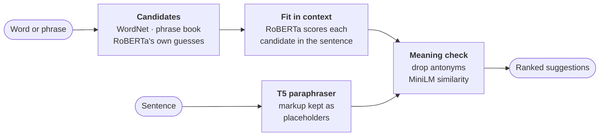

<p align="center">
  
</p>

<h1 align="center">Rewrite</h1>

<p align="center">
  An offline editor that suggests rewrites for words, phrases and sentences, based on the surrounding sentence.<br>
  Works with <code>.txt</code>, <code>.md</code>, <code>.tex</code>, <code>.docx</code>, <code>.pdf</code> and most other text files.
</p>

<p align="center">
  
  
  
  
</p>


## Features

- **Suggestions that fit the sentence.** Word, phrase and sentence alternatives are ranked by how well they fit where they appear, not just taken from a thesaurus.
- **Keeps the meaning.** Antonyms and replacements that change the meaning are filtered out.
- **Auto-rewrite.** Rewrites a selection or the whole document. You can apply every change at once or review them one by one.
- **Leaves markup alone.** LaTeX, Markdown, HTML and code are never changed.
- **Spelling and grammar.** Misspelled words get a red underline and grammar slips a blue one, each with a one-click fix. No extra model is needed.
- **Live preview.** A second panel shows the rendered Markdown as you type, or the PDF of a LaTeX file, rebuilt on every save.
- **Small and private.** It needs no GPU or PyTorch, and works without internet after an optional one-time model download.

## Install

| OS | File | How |
|---|---|---|
| **Windows 10/11** | `Rewrite-1.0.0-Windows-Setup.exe` | Run it. No admin rights needed. It adds a Start-menu entry, *Open with* for text files, and an uninstaller. |
| **macOS 11+** | `Rewrite-1.0.0-macOS-arm64.dmg` | Drag **Rewrite** to Applications. The first time, right-click it and choose **Open** (the app is unsigned). |
| **Debian / Ubuntu** | `rewrite_1.0.0_amd64.deb` | `sudo apt install ./rewrite_1.0.0_amd64.deb` |
| **Any Linux** | `Rewrite-1.0.0-x86_64.AppImage` | `chmod +x Rewrite-*.AppImage`, then run it. |

Python is not required. On first start, Rewrite offers to download three models (~400 MB, one time). If you
skip this, it runs in **Lite mode**, which uses only the thesaurus and phrase book.

## Using it

| Action | How |
|---|---|
| Alternatives for a word | Click the word, then pick one from the panel or press **Alt+1…9** |
| Phrase rewrites | Select 2+ words |
| Rephrase a sentence | **Ctrl+R** |
| Rewrite a selection or the whole document | **Ctrl+Shift+R**, then choose **Replace all** or **Highlight to review** |
| Review a highlighted change | Click it, then **Alt+Y** to accept, **Alt+N** to reject, **F8** for the next one |
| Suggestions at the cursor | **Ctrl+Space** or right-click |
| Fix a spelling or grammar slip | Click the underlined word, then pick the fix in the panel (or right-click it) |
| Open a file | **Ctrl+O**, or drop the file on the window |
| Preview panel | **Ctrl+P**; **F5** or **↻** refreshes it or rebuilds the PDF |

On macOS, use **⌘** instead of **Ctrl**.

**Colour codes:** 🟧 phrase hint (a wordy phrase with ready alternatives) · 🟦 proposed change awaiting review ·
🟩 changed from the original (click it to see the original or revert it) · red underline: not in the dictionary ·
blue underline: grammar slip

**Preview:** Markdown is rendered inside the app. A LaTeX file is compiled with the LaTeX installation on your
computer (MiKTeX, MacTeX or TeX Live), so one must be installed; the build files go to a temporary folder, not next
to your document. While the preview is open, the suggestions move below the text.

**Protected, shown dimmed:**

| Format | What is never changed |
|---|---|
| LaTeX | commands, maths, `\cite` / `\ref` / `\label`, comments, the preamble |
| Markdown | code, link targets, HTML, maths, front matter |
| HTML / XML | tags, entities, scripts, styles |
| Source code | everything except comments and docstrings |
| Everywhere | URLs, e-mail addresses |

**Files:**
- **Open:** txt, md, tex, bib, rst, html, csv, json and source code. From docx, odt, pdf and rtf files, only the text is imported.
- **Save:** txt, md, tex and other plain-text files keep their encoding and line endings. An imported docx, odt, pdf or rtf file is saved as a new file, so the original is never overwritten.

## How it works



| Model (ONNX, int8) | Params | Size | Role |
|---|---|---|---|
| RoBERTa-base | 125M | 128 MB | Ranks candidates by how well they fit the sentence |
| all-MiniLM-L6-v2 | 22M | 24 MB | Rejects replacements that change the meaning |
| T5-base paraphraser | 220M | 253 MB | Rewrites whole sentences and phrases |

Everything runs on the CPU. A word suggestion takes about 0.5 s, and a sentence rewrite about 1 s.

## Run from source

```bash
python run.py            # python3 on macOS/Linux; add a file path to open it
```

The first run creates a private `.venv` (~160 MB) and installs the dependencies (numpy, onnxruntime,
tokenizers, lemminflect, pypdf, tkinterdnd2, pypdfium2). Later runs start right away. It needs Python 3.9+ with
Tkinter:

| OS | Tkinter |
|---|---|
| Windows, macOS | Included with Python from [python.org](https://www.python.org/downloads/). With Homebrew: `brew install python-tk` |
| Ubuntu / Debian | `sudo apt install python3-tk python3-venv` |
| Fedora | `sudo dnf install python3-tkinter` |

## Build the installers

```bash
python packaging/build.py
```

This builds the installer for the **current OS** and puts it in `dist/installers/`. It uses its own
PyInstaller environment in `build/`. The version number comes from `rewrite/__init__.py`.

<details>
<summary><b>Windows</b> → <code>Setup.exe</code></summary>

```powershell
winget install JRSoftware.InnoSetup
python packaging\build.py
```
</details>

<details>
<summary><b>macOS</b> → <code>.dmg</code></summary>

Use Python from python.org, or Homebrew Python with `brew install python-tk`.

```bash
python3 packaging/build.py
```
The .dmg only runs on Macs with the same chip as the Mac that built it (Apple Silicon or Intel).
</details>

<details>
<summary><b>Linux</b> → <code>.deb</code> + <code>.AppImage</code></summary>

```bash
sudo apt install python3-tk python3-venv libfuse2
wget -O appimagetool https://github.com/AppImage/appimagetool/releases/download/continuous/appimagetool-x86_64.AppImage
chmod +x appimagetool && export APPIMAGETOOL=$PWD/appimagetool   # optional: only needed for the AppImage
python3 packaging/build.py
```
If you build on Ubuntu 22.04, the result also runs on older Linux versions.
</details>

<details open>
<summary><b>All three at once on GitHub</b> (no Mac or Linux machine needed)</summary>

Push the project to GitHub, then push a version tag:

```bash
git tag v1.0.0 && git push origin v1.0.0
```

[`installers.yml`](.github/workflows/installers.yml) builds all three installers and attaches them to the
release. You can also start it from **Actions → installers → Run workflow**.
</details>

## Troubleshooting

- **Rebuild the environment:** `python run.py --reinstall`
- **Downloading behind a proxy:** set `HTTPS_PROXY` before starting Rewrite. Interrupted downloads resume.
- **Where data is stored:** `~/.rewrite` for installed apps, or the project folder when running from source.
  Delete `models/` to remove the models.

## Project layout

```
rewrite/app.py        main window (Tkinter)
rewrite/engine.py     suggestion engine: words, phrases, sentences, auto-rewrite
rewrite/nlp/          ONNX wrappers: RoBERTa, MiniLM, T5
rewrite/formats.py    file import/export, protected markup
rewrite/thesaurus.py  WordNet thesaurus + inflection
rewrite/proof.py      spelling and grammar rules
rewrite/mdrender.py   Markdown parser for the preview
rewrite/latexbuild.py LaTeX to PDF for the preview
packaging/            installer build scripts
run.py                run-from-source launcher
```

## A note on use

Rewording someone else's text doesn't make it your own work, and it doesn't remove copyright. Cite your
sources. Rewrite is for improving and varying your own writing.

## Author

**Samrat Dutta** · [github.com/samratduttaofficial](https://github.com/samratduttaofficial)

<sub>Third-party licences: WordNet 3.0 © Princeton University (WordNet licence) · word frequencies from `wordfreq`
(CC BY-SA 4.0) · RoBERTa-base (MIT) · all-MiniLM-L6-v2 (Apache-2.0) · `humarin/chatgpt_paraphraser_on_T5_base`
(OpenRAIL), as ONNX exports from Hugging Face.</sub>
