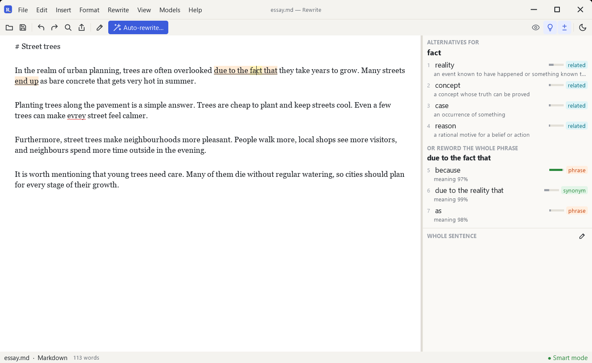

<p align="center">
  
</p>

<h1 align="center">Rewrite</h1>

<p align="center">
  Rewrite any text. Edit any document.<br>
  Make AI drafts read as human, fix grammar, and edit Word, LaTeX and PDF files. Free for Windows, macOS and Linux.
</p>

<p align="center">
  <a href="https://samratduttaofficial.github.io/Rewrite/"><b>Website</b></a> ·
  <a href="https://github.com/SamratDuttaOfficial/Rewrite/releases/latest"><b>Download</b></a>
</p>



## Features

- **Rewrite.** Better words, phrases and whole sentences that fit the sentence.
- **Auto-rewrite.** Rewrite a selection or the whole document, then apply everything or review each change.
  Rewritten text passes AI detectors and plagiarism checkers.
- **Spelling and grammar.** Red and blue underlines, each with a one-click fix.
- **Live preview.** Rendered Markdown as you type, the PDF of a LaTeX file, or a formatted document as it prints.
- **Markup stays intact.** LaTeX, Markdown, HTML and code are never changed.
- **Word, OpenDocument and RTF.** Open and save .docx, .odt, .fodt, .rtf and .doc with their formatting: styles,
  lists, pictures, tables, charts, formulas, footnotes and links, with a formatting toolbar to edit them.
- **PDF.** Highlight, underline, strike out, add notes, draw, white out, add text and pictures, change a line of text
  in place, and turn, move, delete, insert or merge pages.
- **Export and convert.** Write any of them as PDF, Word, OpenDocument, RTF, HTML, Markdown, LaTeX or plain text.
  PDFs become editable documents with headings, lists, tables and pictures.
- **Free.** No account and no word limit. Works offline.

## Install

Download the file for your system from the [website](https://samratduttaofficial.github.io/Rewrite/) or the
[latest release](https://github.com/SamratDuttaOfficial/Rewrite/releases/latest). For a system without an installer,
the website explains how to build one and send it in.

| System | File | How |
|---|---|---|
| Windows 10/11 | `Rewrite-2.0.1-Windows-Setup.exe` | Run it. No admin rights needed. |
| Windows 11 on ARM | `Rewrite-2.0.1-Windows-arm64-Setup.exe` | Run it. No admin rights needed. |
| macOS 15+, Apple Silicon | `Rewrite-2.0.1-macOS-arm64.dmg` | Drag to Applications. The first time, right-click and choose **Open**. |
| macOS 15+, Intel | `Rewrite-2.0.1-macOS-x86_64.dmg` | Drag to Applications. The first time, right-click and choose **Open**. |
| Debian / Ubuntu | `rewrite_2.0.1_amd64.deb`, `rewrite_2.0.1_arm64.deb` | `sudo apt install ./rewrite_2.0.1_amd64.deb` |
| Other Linux | `Rewrite-2.0.1-x86_64.AppImage`, `Rewrite-2.0.1-aarch64.AppImage` | `chmod +x` it, then run it. |

On first start, Rewrite offers a one-time download (about 400 MB) for its best suggestions. Skip it to run in Lite
mode.

## Use

| To | Do this |
|---|---|
| See alternatives | Click a word, or select a phrase |
| Rephrase a sentence | **Ctrl+E** |
| Rewrite a selection or the whole document | **Ctrl+Shift+R** |
| Fix a spelling or grammar slip | Click the underlined word |
| Find and replace | **Ctrl+F**, **Ctrl+H** (or **Ctrl+R**); **F3** finds the next match |
| Open a file | **Ctrl+O**, or drop it on the window |
| Preview Markdown, LaTeX or a formatted document | **Ctrl+P**; **F5** rebuilds |
| Export or convert | **Ctrl+Shift+E** |
| Format text in a Word or OpenDocument file | **Ctrl+B**, **Ctrl+I**, **Ctrl+U**, **Ctrl+K** for a link, or the toolbar |

On macOS, use **⌘** instead of **Ctrl**. Press **F1** in the app for the full guide.

Rewrite opens txt, md, tex, html and source code as text; docx, doc, odt, fodt and rtf as formatted documents; and
pdf files in its PDF view. The LaTeX preview and LaTeX exports need a LaTeX installation (MiKTeX, MacTeX or TeX Live);
saving as .doc, and PDF exports typeset by LibreOffice, need LibreOffice.

## Run from source

```bash
cargo xtask run
```

Rewrite is written in Rust with GTK 4. You need [Rust](https://rustup.rs) and GTK 4's development files:

| System | GTK 4 |
|---|---|
| Windows | [MSYS2](https://www.msys2.org), then `pacman -S mingw-w64-ucrt-x86_64-gtk4 mingw-w64-ucrt-x86_64-pkgconf mingw-w64-ucrt-x86_64-gcc`, with `C:\msys64\ucrt64\bin` on `PATH` and Rust's `stable-x86_64-pc-windows-gnu` toolchain |
| Windows on ARM | MSYS2's CLANGARM64 environment: `pacman -S mingw-w64-clang-aarch64-gtk4 mingw-w64-clang-aarch64-pkgconf mingw-w64-clang-aarch64-toolchain mingw-w64-clang-aarch64-rust`, with `C:\msys64\clangarm64\bin` on `PATH` |
| macOS | `brew install gtk4 pkg-config` |
| Debian / Ubuntu | `sudo apt install libgtk-4-dev` |

The first run downloads ONNX Runtime and PDFium into `runtime/`. Microsoft publishes no ONNX Runtime for Intel Macs,
so there [build it](https://onnxruntime.ai/docs/build/inferencing) with `--build_shared_lib` and set `ORT_LIB_DIR` to
the folder with the library. `cargo test` runs the tests.

## Build the installers

```bash
cargo xtask package
```

This builds the installer for the current system into `dist/installers/` (on Windows it needs Inno Setup 6; on
Linux, `linuxdeploy` for the AppImage). Pushing a version tag such as `v1.0.0` builds them all, for x64 and ARM64, on
GitHub Actions and attaches them to the release.

## Licence

Free to use, share and change, under the [MIT licence with the Commons Clause](LICENSE): keep the copyright notice
when you reuse the code, and do not sell Rewrite or a product built mainly on it.

## Credits

Made by **Samrat Dutta** · [github.com/samratduttaofficial](https://github.com/samratduttaofficial)

Rewording someone else's text does not make it your own work. Cite your sources.

<sub>WordNet 3.0 © Princeton University · word frequencies from `wordfreq` (CC BY-SA 4.0) · RoBERTa-base (MIT) ·
all-MiniLM-L6-v2 (Apache-2.0) · `humarin/chatgpt_paraphraser_on_T5_base` (OpenRAIL), run with ONNX Runtime ·
lemminflect (MIT) · PDFium (BSD) · GTK (LGPL).</sub>
